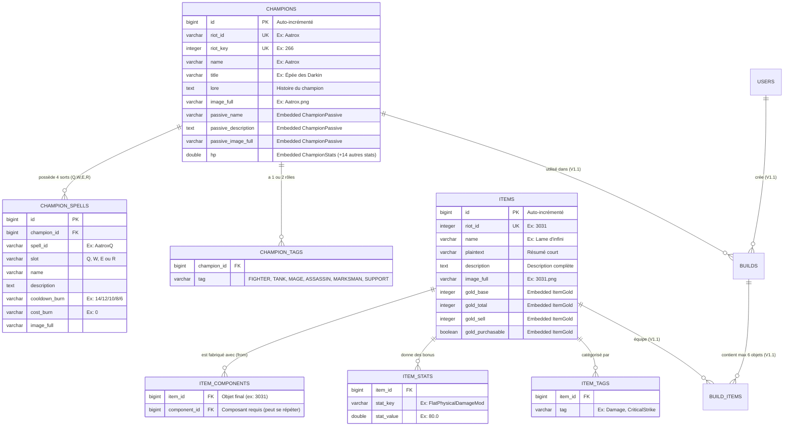

# Modélisation du Domaine (DDD) et Schéma de Base de Données

Ce document résume le modèle métier et relationnel validé à l'**Étape 1**.

---

## 1. Découpage en Domaines (*Package by Feature*)

```text
com.leagueplatform
 ├── champion/     (Agrégat Champion : Champion, ChampionStats, ChampionPassive, ChampionSpell, ChampionTag)
 ├── item/         (Agrégat Item : Item, ItemGold)
 ├── build/        (Jalon V1.1 : Build)
 ├── user/         (Jalon V1.1 : User)
 └── shared/       (Configuration, Exceptions RFC 9457, Synchronisation Data Dragon)
```

---

## 2. Diagramme Entité-Relation (Schéma SQL PostgreSQL)



---

## 3. Résumé des choix DDD & JPA (V1.0 + anticipation V1.1)

| Concept Métier | Nature DDD | Mapping JPA | Table SQL |
| :--- | :--- | :--- | :--- |
| **`Champion`** | Racine d'Agrégat (*Aggregate Root*) | `@Entity` (`id` `BIGINT` + `riotId` `UNIQUE`) | `champions` |
| **`ChampionStats`** | Objet-Valeur (*Value Object*) | `@Embeddable` / `@Embedded` | Colonnes dans `champions` |
| **`ChampionPassive`** | Objet-Valeur (*Value Object*) | `@Embeddable` / `@Embedded` | Colonnes dans `champions` |
| **`ChampionSpell`** | Entité enfant interne à `Champion` | `@Entity` (`@OneToMany(cascade = ALL, orphanRemoval = true)`) | `champion_spells` |
| **`ChampionTag`** | Valeur énumérée | `enum` + `@ElementCollection` (`EnumType.STRING`) | `champion_tags` |
| **`Item`** | Racine d'Agrégat (*Aggregate Root*) | `@Entity` (`id` `BIGINT` + `riotId` `UNIQUE`) | `items` |
| **`ItemGold`** | Objet-Valeur (*Value Object*) | `@Embeddable` / `@Embedded` | Colonnes dans `items` |
| **Recette (`from`)** | Relation vers d'autres `Item` | `@ManyToMany` avec `List<Item>` (autorise les doublons) | `item_components` |
| **Stats d'un `Item`** | Paires clé/valeur dynamiques | `@ElementCollection` avec `Map<String, Double>` | `item_stats` |
| **`User` & `Build` (V1.1)** | Racines d'Agrégat | `Build` pointera vers `champions(id)` et `items(id)` | `users`, `builds`, `build_items` |

